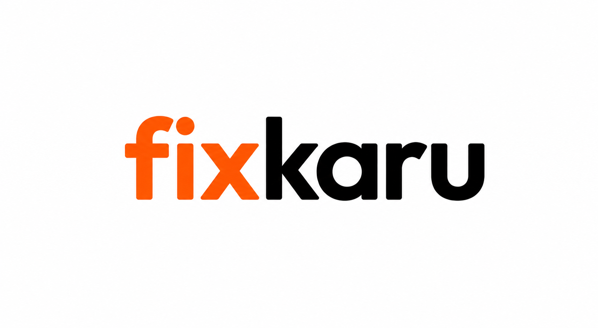

   
  
  
  <h3>Convenience at Your Doorstep.</h3>

  

    On-demand smartphone repair delivered to your door. Transparent pricing, verified technicians, and repairs completed right in front of you.
  

  

    
    
  

---

### What We Do

Traditional device repair is inconvenient, opaque, and stressful. Visiting crowded electronics markets, leaving personal devices behind for days, and dealing with arbitrary pricing should not be the norm.

**fixkaru** reimagines tech care into a reliable, doorstep service:
- **Price First**: Instant, transparent model-wise pricing before you book. No hidden fees or surprise calls.
- **Watch It Happen**: An expert technician arrives at your doorstep and repairs your device right in front of you. You never have to hand over your unlocked phone and wonder.
- **Pay When It Works**: You test the hardware, verify everything functions perfectly, and pay only after you're completely satisfied.

---

### What We Build

Our engineering team builds the technology powering on-demand doorstep hardware services across three core pillars:

- **Customer Experience** — Frictionless web and mobile booking interfaces with instant diagnostics, model-wise pricing estimation, and real-time appointment scheduling.
- **Field Operations & Dispatch** — Intelligent technician routing, live doorstep navigation, and digital checklists ensuring consistent quality standards across every repair.
- **Supply Chain & Quality Control** — High-precision spare parts inventory tracking, hardware component verification, and automated post-service warranty management.

---

### Open Source & Community

While our core product infrastructure is proprietary, we are proud to build with and contribute to the modern developer ecosystem. Watch this space for upcoming open-source developer tooling, libraries, and design resources from our team.

---

### Get In Touch

- 🌐 **Platform**: [fixkaru.com](https://www.fixkaru.com)
- 🛠️ **Book a Service**: [fixkaru.com/book](https://www.fixkaru.com/services)
- 💼 **LinkedIn**: [linkedin.com/company/fixkaru](https://www.linkedin.com/company/fixkaru/)
- ✉️ **Contact**: [fixkaru@gmail.com](mailto:fixkaru@gmail.com)

 

  © 2026 fixkaru Technologies. All rights reserved.

